# Autonomous Tracking Turret

A two axis turret that finds a person on camera, keeps them centered, and fires foam darts with CO2.

| Context | Dates | My role | Partner | Tools | Outcome |
|---|---|---|---|---|---|
| Personal project | Summer 2025 | Mechanical design, electronics, firmware | Jinson Jimmy, University of Maryland (pose tracking software) | SolidWorks, Desmos, ESP32 (Arduino C++), Python | Working tracking and firing prototype, under $150 |

**Case study:** [PDF](docs/Turret_Case_Study.pdf) · [web version](https://xiang-wang-us.github.io/projects/turret.html)

## Highlights

- **12:1 and 18:1** printed cycloidal reducers on NEMA 17 steppers
- **97%** of peak modeled dart speed from a 0.3 m barrel
- **2 weeks** hardware build for under $150

## Summary

I designed and built the hardware for a turret that tracks a person and fires foam darts. Direct drive steppers could not move the top heavy head, so I designed printed cycloidal reducers for both axes. An ESP32 streams video to a laptop that runs pose detection and sends aim corrections back over UDP.

## Requirements and first prototype

The goal was a turret that points a launcher at a moving person automatically, on a student budget. From the first brainstorm I fixed four choices: two axes, CO2 instead of springs, stepper motors, and an ESP32 instead of a Raspberry Pi. Each one was picked for cost and simplicity. The base motor rotates with the head so the turret can sweep a full 360 degrees without twisting its wiring.

The first prototype drove both axes directly. It spun freely with no load, but the base NEMA 17 could not turn the finished head. The fix had to add torque without adding much size or a larger motor.

<table>
<tr><td width="50%" valign="top">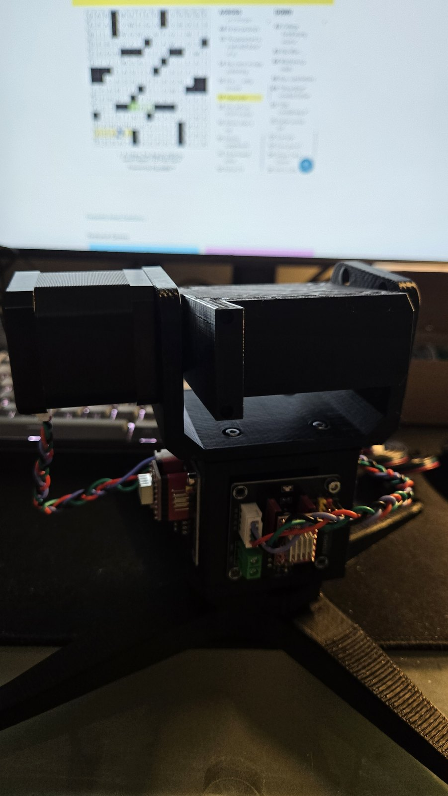 First prototype: direct drive, before reduction</td><td width="50%" valign="top">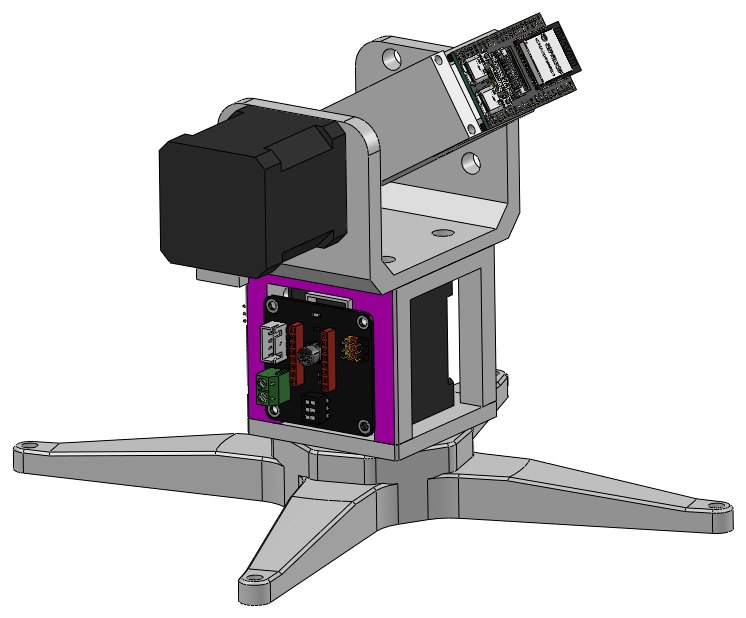 First prototype CAD: both axes direct drive</td></tr>
<tr><td width="50%" valign="top">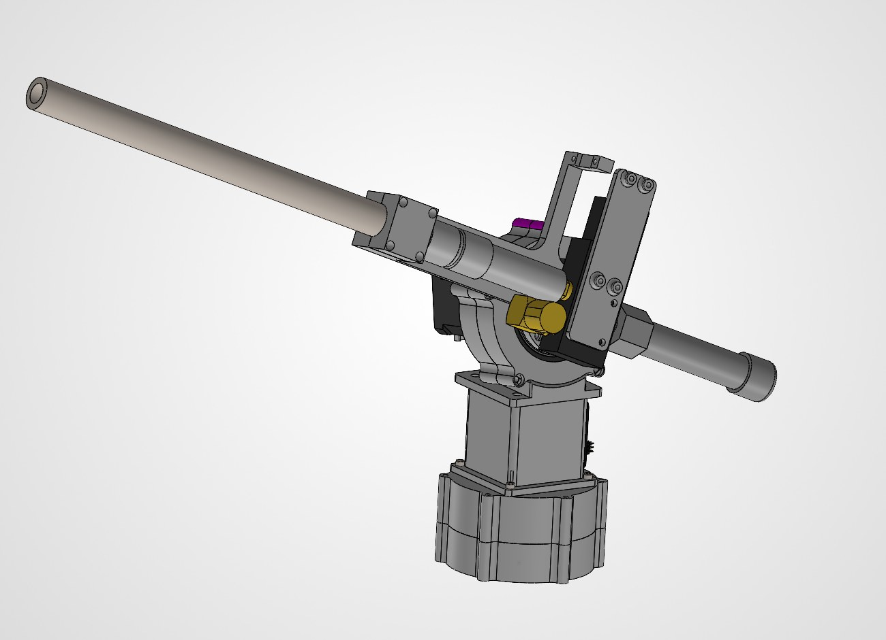 Final CAD: reducers on both axes, barrel, and gas system</td></tr>
</table>

## Cycloidal reducers

A cycloidal drive gives a high ratio in a single compact stage and runs quietly, and every part can be printed. I derived the cycloid disc profile parametrically in Desmos, adjusting pin count, pin radius, and eccentricity, then brought the curve into SolidWorks as the disc sketch.

The result was two drives: 18:1 for azimuth and 12:1 for elevation, both on NEMA 17 steppers. I checked each printed drive by hand for smooth engagement before mounting it, then designed the brackets that tie the two axes together.

<table>
<tr><td width="50%" valign="top">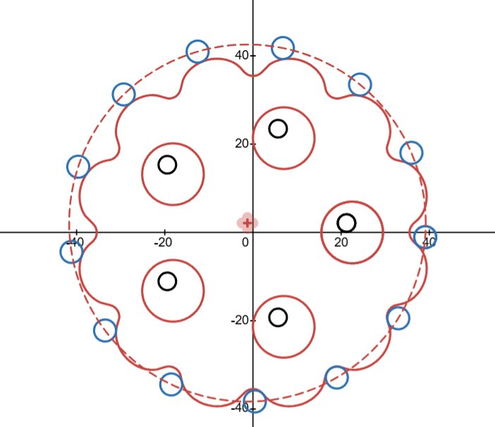 Disc profile and pin circle generated in Desmos</td><td width="50%" valign="top">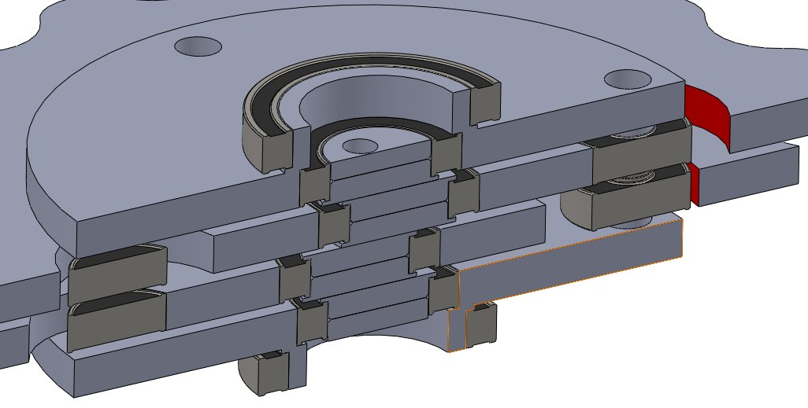 Section through the reducer stack</td></tr>
<tr><td width="50%" valign="top">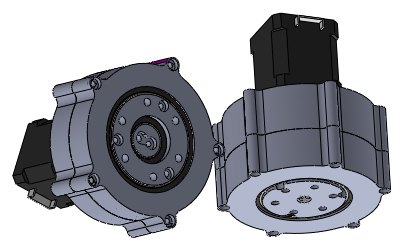 Elevation and azimuth drives</td></tr>
</table>

Videos: [Printed drive turning by hand](media/video/turret_cycloid.mp4)

## CO2 firing system

Gas path: CO2 cartridge, regulator, a small shot chamber, a 3/2 way solenoid valve, then the barrel. On the bench the valve clicked at 12 V but never shifted, and raising the voltage changed nothing. Cycling it by hand only opened one set of ports. The cause was supply pressure: the valve will not shift below about 20 psi, which is typical of pilot operated valves, so it could never cycle on an unpressurized bench.

To size the chamber and barrel I modeled the shot as isothermal expansion pushing a 1 g dart. At 60 psi the model predicts about 100 m/s after 0.3 m of travel, which is 97% of the model's peak speed, with 37 kPa still in the chamber. A longer barrel adds almost nothing. The model ignores friction, so the real setting needs some margin. An early live shot broke the dart outright.

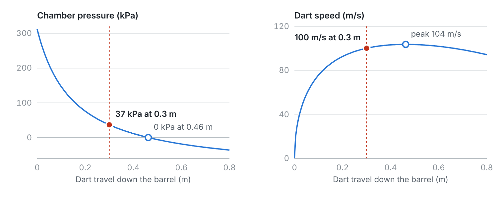 Shot chamber model: pressure and dart speed against travel, 60 psi, 1 g dart. Red marks the 0.3 m barrel.

<table>
<tr><td width="50%" valign="top">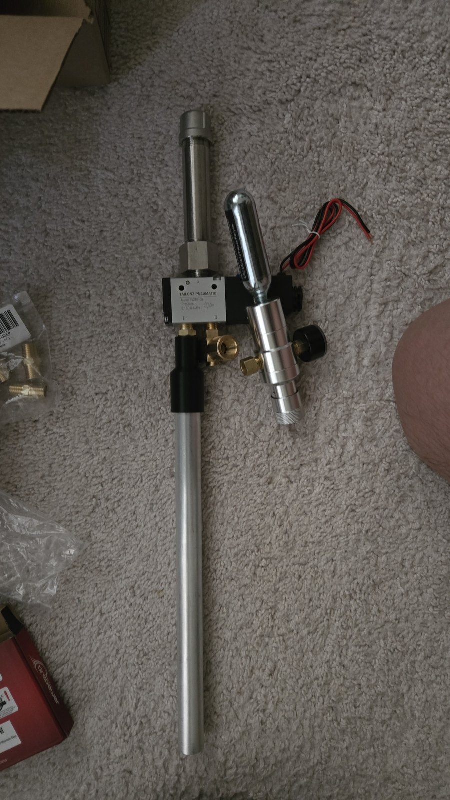 Gas path laid out before mounting</td><td width="50%" valign="top">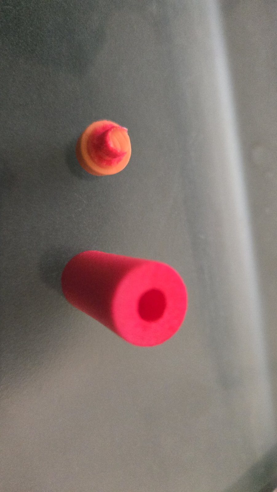 An early test shot broke the dart</td></tr>
</table>

## Electronics and firmware

An ESP32 with a camera runs everything on the turret. Two A4988 drivers on a 12 to 24 V rail drive the steppers, an AS5600 magnetic encoder reads the pitch axis over I2C, and relays switch the 12 V solenoid valves. Before wiring I audited every ESP32 pin for strapping, UART, and USB conflicts so nothing would fight the boot sequence.

Tracking is split across two machines. The ESP32 streams video over WiFi and executes motion and firing. A laptop runs MediaPipe pose detection, written by Jinson, and sends aim corrections over UDP. The firmware turns each correction into stepper moves with AccelStepper.

<table>
<tr><td width="50%" valign="top">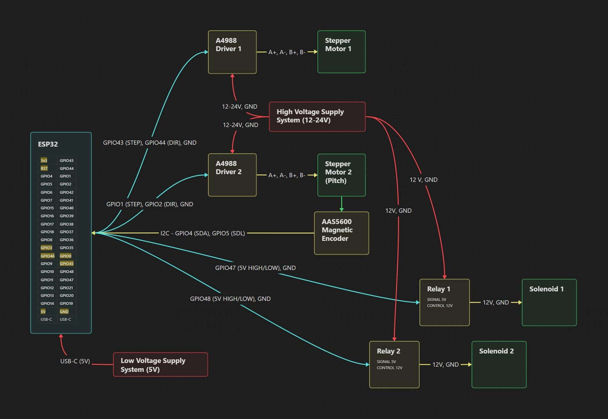 System wiring</td><td width="50%" valign="top">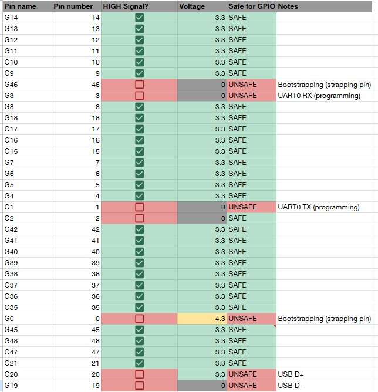 ESP32 pin audit: green pins are safe to drive at boot</td></tr>
</table>

Videos: [Both axes moving under firmware control](media/video/turret_motion.mp4), [Motion and fire sequence (gas off to save cartridges)](media/video/turret_fire.mp4)

## Results and next steps

The prototype moved both axes under firmware control, ran the fire sequence, and fired darts on the bench. The limits were in the camera path: the ESP32 was slow to capture and send frames, could not run detection locally, and its camera resolution capped tracking range.

Next steps: a battery so the turret runs untethered, a single board computer to run detection on the turret, and automatic dart feeding.

<table>
<tr><td width="50%" valign="top">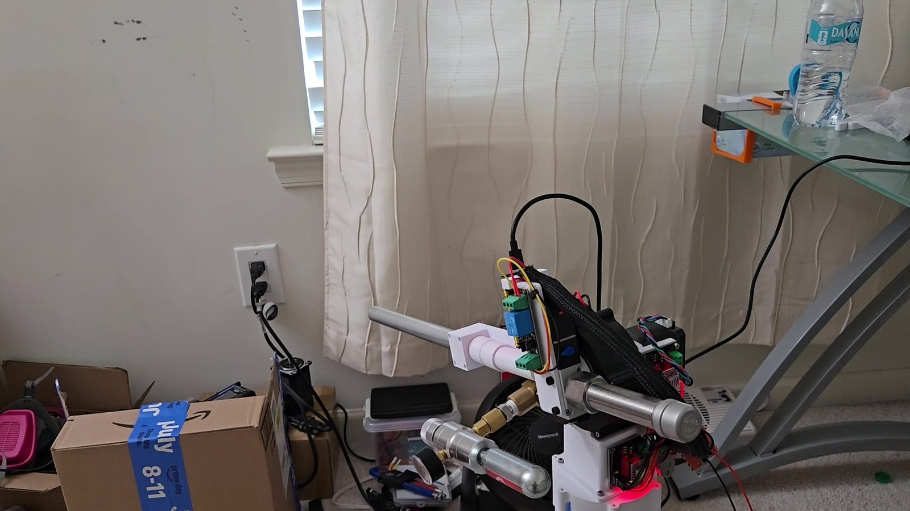 Running the motion and fire sequence</td></tr>
</table>

## Run the code

**Tracker (laptop):** Python 3 with `opencv-python`, `numpy`, and `mediapipe` (`pip install -r src/python/requirements.txt`). Set `ESP32_IP` in `src/python/main.py`, then run it. It sends aim corrections to the turret over UDP port 1234.

**Firmware (ESP32):** open `src/camera-web-server/camera-web-server.ino` in the Arduino IDE with the ESP32 board package and the `AccelStepper` library installed (`WiFi.h`, `WiFiUdp.h`, and `esp_camera.h` ship with the board package). Fill in the WiFi credentials and flash. The camera stream is served at `http://<ESP32_IP>/stream`.

## Files

| File | Path |
|---|---|
| Case study (PDF) | [`docs/Turret_Case_Study.pdf`](docs/Turret_Case_Study.pdf) |
| Design journal (PDF) | [`docs/Turret_Design_Journal.pdf`](docs/Turret_Design_Journal.pdf) |
| 18:1 cycloidal drive (STEP) | [`Hardware/cycloidal_drive_18_1/18-1 Cycloidal Drive Assembly.STEP`](Hardware/cycloidal_drive_18_1/18-1%20Cycloidal%20Drive%20Assembly.STEP) |
| 12:1 cycloidal drive (STEP) | [`Hardware/cycloidal_drive_12_1/12-1 Cycloidal Drive Assembly.STEP`](Hardware/cycloidal_drive_12_1/12-1%20Cycloidal%20Drive%20Assembly.STEP) |
| ESP32 firmware | [`src/camera-web-server`](src/camera-web-server) |
| Pose tracking script | [`src/python/main.py`](src/python/main.py) |

## Credits

Pose tracking software by Jinson Jimmy (University of Maryland).

---

Part of [Xiang Wang's engineering portfolio](https://xiang-wang-us.github.io). [LinkedIn](https://linkedin.com/in/xiangwang102) · [Email](mailto:20o5xwang@gmail.com)
